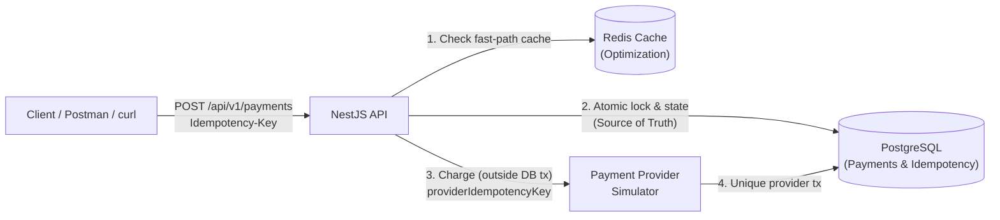
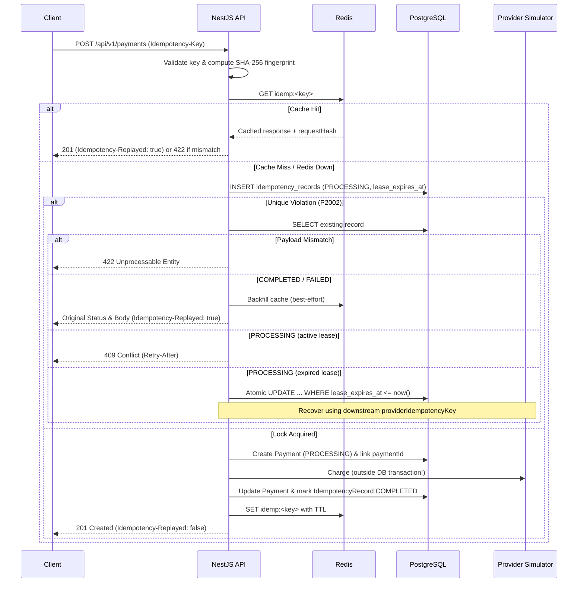

# Idempotency in Distributed Systems (NestJS, PostgreSQL, Redis & Docker)

A production-style backend application demonstrating **Idempotency in Distributed Systems**, built for a technical YouTube tutorial using **NestJS**, **PostgreSQL (Prisma)**, **Redis**, and **Docker Compose**.

---

## 1. Project Overview

In distributed payment systems, network failures, client retries, mobile app double-taps, and gateway timeouts are inevitable. Without idempotency, retrying a `POST /api/v1/payments` request can accidentally charge a customer multiple times.

This project demonstrates how to build a **safe, concurrency-resilient, crash-recoverable idempotent payment API** where clients can retry requests with confidence.

## 2. Why Idempotency Matters

In HTTP/REST APIs:
- `GET`, `PUT`, and `DELETE` are naturally idempotent.
- `POST` (creating a payment) is **not** idempotent by default.

If a client sends a payment request and the response is lost due to a network timeout, the client does not know whether:
1. The server never received the request,
2. The server failed before charging, or
3. The payment succeeded and only the response was lost.

**Idempotency** guarantees that repeating the same logical operation with the same `Idempotency-Key` produces the same side effect (at most one charge) and returns the same logical response.

## 3. Real-World Payment Example

1. Client generates a unique `Idempotency-Key: payment-order-1001` for an order checkout.
2. Client sends `POST /api/v1/payments` with `{ "amount": 5000, "currency": "PKR", "customerReference": "customer-101" }`.
3. If the network drops, the client safely retries with `Idempotency-Key: payment-order-1001`.
4. The server detects the key, verifies the payload fingerprint matches, and returns the original payment result without charging again.

## 4. Technology Stack

| Component | Technology |
|---|---|
| Backend | NestJS 11 |
| Language | TypeScript |
| Runtime | Node.js 22 LTS |
| Database | PostgreSQL 16 + Prisma 6 |
| Cache | Redis 7 (`ioredis`) |
| API Docs | Swagger / OpenAPI (`/api/docs`) |
| Validation | `class-validator`, `class-transformer` |
| Logging | `nestjs-pino` (structured JSON / pretty dev logs) |
| Testing | Jest + Supertest |
| Containerization | Docker & Docker Compose |
| Package Manager | `pnpm` |

## 5. System Architecture

The application is structured as a modular monolith with strict separation of concerns:

- **PaymentsModule**: HTTP endpoints, DTO validation, payment orchestration.
- **IdempotencyModule**: Key validation, deterministic SHA-256 request fingerprinting, atomic PostgreSQL lock acquisition, lease recovery, and Redis caching.
- **PaymentProviderModule**: Internal gateway simulator with its own `provider_transactions` table and unique `provider_idempotency_key` constraint.
- **DatabaseModule**: Prisma client lifecycle, connection management, and health checks.
- **RedisModule**: Best-effort caching layer with graceful fallback to PostgreSQL.
- **HealthModule**: Liveness (`/health/live`) and readiness (`/health/ready`) probes.

## 6. Architecture Diagram



## 7. Idempotency Request Lifecycle



## 8. Database Schema Explanation

Defined in [schema.prisma](file:///Users/muhammadirfanali/Desktop/Youtube%20Teaching%20Projects/idempotency-in-distributed-systems/prisma/schema.prisma) and managed via Prisma migrations:

- **`payments`**: Stores payment state (`PENDING`, `PROCESSING`, `SUCCEEDED`, `FAILED`), `amount`, `currency`, `customer_reference`, and `provider_transaction_id`.
- **`idempotency_records`**: Authoritative idempotency state with:
  - `@unique` constraint on `key`
  - `request_hash` (SHA-256 of canonicalized business payload)
  - `status` (`PROCESSING`, `COMPLETED`, `FAILED`)
  - `lease_expires_at` for crash recovery
  - `expires_at` for retention TTL
  - `response_status_code` & `response_body` (JSON)
- **`provider_transactions`**: Simulates the external payment gateway's own ledger with a `@unique` constraint on `provider_idempotency_key` to prevent duplicate charges during retries or crash recovery.

## 9. PostgreSQL and Redis Responsibilities

| Concern | PostgreSQL | Redis |
|---|---|---|
| Correctness & Atomicity | **Source of Truth** (unique constraints, transactions) | Not used for correctness |
| Concurrent Locking | Atomic `INSERT` (`P2002` handling) + optimistic lease `UPDATE` | Not used |
| Crash & Timeout Recovery | Stores `PROCESSING` state, `payment_id`, `lease_expires_at` | Not used |
| Completed Response Replay | Authoritative fallback | **Fast-path cache** with TTL |
| Outage Behavior | Required for writes (`/health/ready` -> `503`) | Graceful fallback (`/health/ready` -> `degraded`, `200`) |

## 10. Concurrency Handling

1. **No Check-Then-Insert Race Conditions**: We never do `findFirst()` followed by `create()`. Instead, we attempt an atomic `INSERT` into `idempotency_records` and catch PostgreSQL unique constraint violation (`P2002`).
2. **Short Transactions Only**: Database transactions are never held open while waiting on the external payment provider.
3. **Optimistic Lease Recovery**: Expired `PROCESSING` leases are claimed atomically via `UPDATE ... WHERE key = $1 AND status = 'PROCESSING' AND lease_expires_at <= now()`, ensuring only one recovery worker wins.

## 11. Failure Recovery Strategy

Because PostgreSQL and an external payment provider cannot participate in a single distributed ACID transaction:
- **Client Timeout (`504`)**: The provider may have already charged the card before the response timed out. On timeout, the API releases the processing lease immediately so the client's retry recovers the existing `ProviderTransaction` without double-charging.
- **Worker Crash (`crash_after_provider`)**: If the server crashes after calling the provider but before marking `IdempotencyRecord` as `COMPLETED`, the `lease_expires_at` eventually expires. A subsequent retry atomically claims the expired lease and recovers the `ProviderTransaction` via `provider_idempotency_key`.

## 12. API Endpoint Documentation

| Method | Endpoint | Description |
|---|---|---|
| `POST` | `/api/v1/payments` | Create an idempotent payment (requires `Idempotency-Key` header) |
| `GET` | `/api/v1/payments/:paymentId` | Retrieve a payment by UUID |
| `GET` | `/api/v1/payments` | List payments with pagination and filters |
| `GET` | `/api/v1/idempotency/:key` | Inspect sanitized idempotency record status |
| `GET` | `/health` | Overall health summary |
| `GET` | `/health/ready` | Readiness probe (`200` if Postgres up, `503` if down) |
| `GET` | `/health/live` | Liveness probe (`200` if process alive) |

Simulator header for testing (`POST /api/v1/payments`):
- `X-Simulate-Behavior`: `success` | `fail` | `delay` | `timeout` | `crash_after_provider`

## 13. Environment Variable Configuration

Templates provided:
- `.env.example` — Default Docker Compose configuration
- `.env.development` — Local development overrides
- `.env.production.example` — Production template (replace all placeholder secrets)

All variables are validated at startup using Joi (`src/config/env.validation.ts`).

## 14. Docker Installation Prerequisites

- Docker Engine 24+ / Docker Desktop
- Docker Compose v2+

No local Node.js, PostgreSQL, or Redis installation is required to run the stack.

## 15. How to Run the Complete Application Using Docker Compose

```bash
# 1. Copy environment template
cp .env.example .env

# 2. Build and start all services (PostgreSQL, Redis, NestJS app)
docker compose up --build -d

# 3. Check container status
docker compose ps
```

## 16. How to View Application Logs

```bash
docker compose logs -f app
```

## 17. How to Access Swagger

Open in your browser:

```text
http://localhost:3000/api/docs
```

## 18. How to Run Database Migrations

Migrations run automatically on container startup. To run manually:

```bash
docker compose exec app pnpm prisma:deploy
```

## 19. How to Run Automated Tests

```bash
# Unit tests (no external DB/Redis required)
docker compose exec app pnpm test:unit

# Integration tests (requires PostgreSQL & Redis)
docker compose exec app pnpm test:integration

# End-to-End tests (requires PostgreSQL & Redis)
docker compose exec app pnpm test:e2e
```

## 20. Postman Collection & Swagger UI

- **Swagger UI**: Open `http://localhost:3000/api/docs` to test endpoints interactively or export `/api/docs-json` / `/api/docs-yaml`.
- **Postman Collection**: Import [Idempotency-System.postman_collection.json](file:///Users/muhammadirfanali/Desktop/Youtube%20Teaching%20Projects/idempotency-in-distributed-systems/postman/Idempotency-System.postman_collection.json) into Postman.

## 21. How to Stop the Containers

```bash
docker compose down
```

## 22. How to Remove Containers and Persistent Volumes

```bash
docker compose down -v
```

## 23. Common Troubleshooting Scenarios

- **Port 3000 already in use**: Set `PORT=3001` in `.env` and restart `docker compose up -d`.
- **Docker daemon not running**: Start Docker Desktop before running `docker compose`.
- **Database connection refused on startup**: `docker-compose.yml` uses `depends_on` with `condition: service_healthy`; wait a few seconds for PostgreSQL healthcheck to pass.

## 24. Production Considerations

- Run periodic cleanup jobs to purge expired `idempotency_records` (`WHERE expires_at < NOW()`).
- Enable TLS for PostgreSQL and Redis connections and inject secrets via a secrets manager.
- Scope idempotency keys per authenticated tenant/merchant (`<tenantId>:<key>`) in multi-tenant systems.

## 25. Known Limitations

- The payment provider is an internal simulator backed by PostgreSQL rather than a live third-party gateway.
- In-memory rate limiting (`@nestjs/throttler`) is per-instance; for multi-replica deployments, back throttler storage with Redis.
